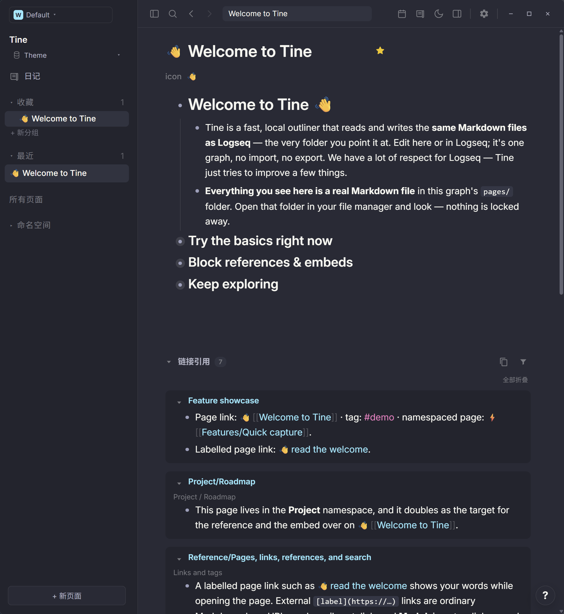
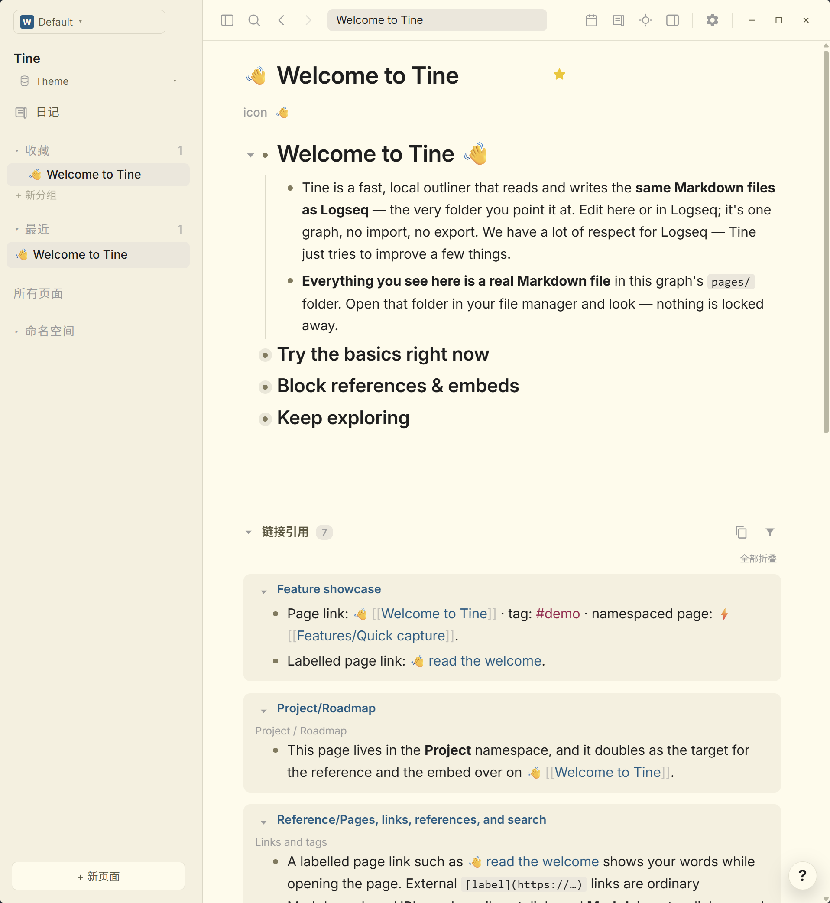

# Dracula · Prism

**紫暮在窗前停驻，晨光落在温暖的纸页上。让思绪有微光，让微光慢慢成为文字。**

[English](README.md) · [下载 theme.json](https://github.com/EllisMorrow/tine-theme-dracula-prism/releases/latest/download/theme.json)

Prism 系列的明暗双生：Dracula 的紫色夜幕，与官方 Alucard 的温暖纸页。青蓝链接与玫粉标签，让思绪各有归处。

在 [Prism 主题画廊](https://github.com/martinkoutecky/tine/discussions/786)中，可以直观比较全部 29 个主题的浅色与深色效果。

### 深色模式

### 浅色模式

*用户测试后提供的 Windows 实机截图，两套配色均实际包含在同一个主题包中。*

## 安装

1. 下载 [theme.json](https://github.com/EllisMorrow/tine-theme-dracula-prism/releases/latest/download/theme.json)。
2. 在 Tine 打开 **设置 → 外观 → 主题包 → 选择 theme.json**，选择下载的文件。
3. 点击 **使用颜色**，选择 **浅色、深色或跟随系统**。

需要主题 API **0.2** 支持。原有 `logseq/custom.css` 和设备强调色可能影响效果；主题只负责 API 支持的颜色，不包含额外字体、布局或任务标记样式。

## 配色

| 角色 | 浅色 | 深色 |
| --- | --- | --- |
| 主背景 | `#fffbeb` | `#282a36` |
| 侧栏 | `#f5f0df` | `#22242e` |
| 正文 | `#1f1f1f` | `#f8f8f2` |
| 标题 | `#1f1f1f` | `#f8f8f2` |
| 强调色 | `#644ac9` | `#bd93f9` |
| 链接 | `#035d84` | `#8be9fd` |
| 标签 | `#a3144d` | `#ff79c6` |
| 高亮底色 | `#f1e6ad` | `#48452d` |

## 验证情况

通过官方主题格式检查；浏览器样例检查了两套完整变量、模式切换及指定颜色组合。用户提供了上方 Windows 明暗实机截图，展示公开欢迎页面上的标题、正文、层级、链接、标签、行内代码和引用区域。高亮、选中操作、设置状态和其它平台未由这些截图覆盖，不据此宣称全部路径均已验证。

## 来源与边界

基于 [Dracula / Alucard](https://github.com/dracula/dracula-theme)，固定版本 `e22ebcc048b8aff586f9bc94db30ff5347070b42`，采用 MIT 许可并保留 [原始声明](LICENSE)。深色参考 Codex 中 Dracula 的配色风格，并从开源上游色板独立映射；浅色采用上游官方 Alucard 色板，不声称是 Codex 原生浅色预设。部分背景和文字角色为 Tine 可读性作了适配。

独立社区适配由 EllisMorrow 完成，使用 AI 辅助开发。不分发 Codex 程序代码、标志或附带资源，不代表相关项目或 OpenAI 的官方产品，也不承诺与 Codex 像素级一致。具体映射和验证边界见 [适配说明](docs/adaptation.md)。

顶部徽标统计 GitHub Release 附件累计下载量，不代表安装人数。可在本仓库反馈问题，附版本、系统、模式及不包含私人内容的截图。
